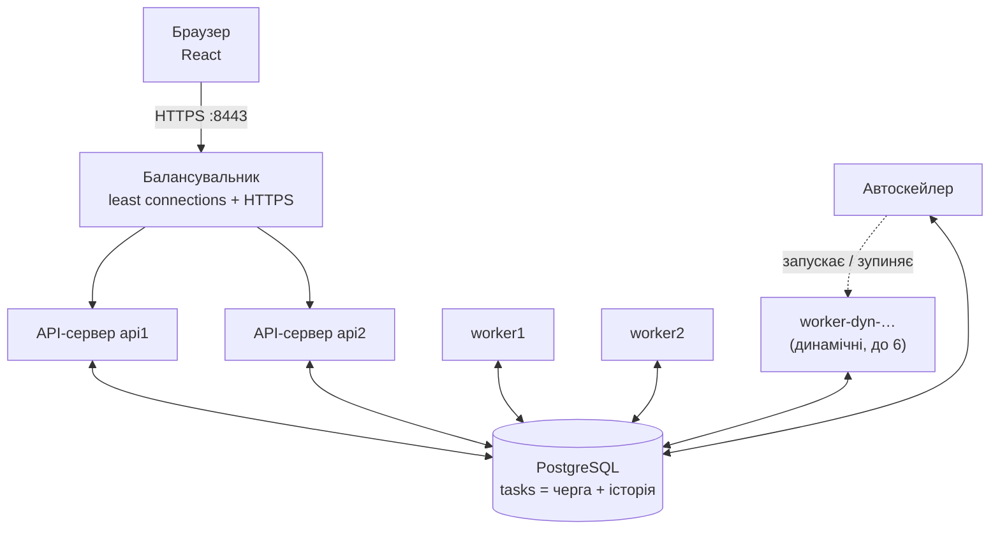

#WEB-project

**Веб-застосунок для виконання трудомістких обчислень з балансуванням навантаження, чергою задач і автоматичним масштабуванням серверів.**

Користувач запускає важку обчислювальну задачу (розв'язування системи лінійних рівнянь, ітераційний пошук √2, чисельне інтегрування) і бачить прогрес у реальному часі. Запити розподіляються між кількома незалежними серверами, а коли ресурсів не вистачає, задачі стають у чергу з орієнтовним часом очікування, і система сама запускає додаткові сервери.

---

## Можливості

### Обчислювальні задачі
| Задача | Метод | Параметр складності | Максимум |
|---|---|---|---|
| Система лінійних рівнянь | Метод Гауса з вибором головного елемента | Кількість невідомих N (складність ~N³) | N = 7000 |
| Пошук √2 | Метод Ньютона в циклі (навантаження на CPU) | Кількість ітерацій | 8 млрд |
| Визначений інтеграл | Формула Сімпсона (sin x, x·sin x, e^(−x²)) | Кількість кроків | 50 млрд |

Найважчі задачі виконуються ~8–9 хвилин. Кожен результат перевіряється: для системи рівнянь рахується похибка й нев'язка, для √2 та інтеграла — відхилення від точного значення.

### Для користувача
- **Реєстрація і вхід.** Паролі зберігаються як bcrypt-хеші, сесія — JWT-токен. Усе працює лише через HTTPS.
- **Прогрес у реальному часі:** відсоток, залишок часу, назва сервера, який рахує задачу.
- **Історія задач** з результатами, статусами й часом виконання.
- **Скасування** задачі в черзі або під час обчислення, тобто обчислення реально зупиняється.
- **Черга:** якщо всі сервери зайняті, користувач бачить позицію в черзі й приблизний час старту та завершення. Сторінку можна закрити, задача все одно виконається.

### Обмеження трудомісткості
- Межі параметрів перевіряються **і в браузері, і на сервері**.
- Якщо оцінений час задачі більший за ліміт (10 хв), сервер **відмовляє** ще до запуску.
- Якщо задача все ж рахується довше ліміту, вона **примусово зупиняється**.
- Не більше 5 активних задач і 50 задач в історії на користувача, не більше 100 задач у черзі системи.

### Масштабування і надійність
- **Балансувальник навантаження** розподіляє запити між двома API-серверами (least connections) і обходить сервер, що не відповідає.
- **Щонайменше 2 сервери обчислень**, які самі забирають задачі з черги. Зайнятий сервер нових задач не бере.
- **Автомасштабування:** при великій черзі автоматично запускаються нові сервери (до 6), при простої зайві вимикаються.
- **Відмовостійкість:** якщо сервер обчислень впав, його задачі автоматично повертаються в чергу й дораховуються іншим сервером.

### Панель адміністратора
- Кількість задач у черзі, зайняті слоти, сервери онлайн, кількість серверів, доданих автоскейлером.
- Графік навантаження в часі.
- Таблиця серверів: стан, кількість задач, пам'ять, кількість виконаних задач, час останнього сигналу.
- Усі активні задачі всіх користувачів з можливістю скасування.

---

## Технології

| Шар | Технології |
|---|---|
| **Backend** | Node.js 18+, Express, `worker_threads` |
| **База даних** | PostgreSQL |
| **Frontend** | React 18, Vite |
| **Авторизація** | JWT (`jsonwebtoken`), `bcryptjs` |
| **Балансувальник** | Власний на Node.js (`https`, least connections) або Nginx у Docker |
| **Контейнеризація** | Docker, Docker Compose, `dockerode` для автомасштабування |

Увесь код, і бекенд, і фронтенд, написаний на JavaScript (ES-модулі).

---

## Архітектура



| Компонент | Роль | Кількість |
|---|---|---|
| **Балансувальник** | Єдина точка входу: HTTPS, розподіл запитів між API, віддача сайту | 1 |
| **API-сервер** | Авторизація, перевірка лімітів, постановка задач у чергу, читання стану. Сам нічого не рахує | 2 (api1, api2) |
| **Сервер обчислень (worker)** | Забирає задачі з черги, рахує в окремому потоці, пише прогрес і результат | 2 постійні + до 4 динамічних |
| **Автоскейлер** | Стежить за чергою, запускає й зупиняє worker-и, відновлює задачі впалих серверів | 1 |
| **PostgreSQL** | Спільне сховище: користувачі, задачі (черга), сервери, метрики | 1 |

**Ключова ідея: компоненти не викликають один одного напряму, уся координація йде через базу даних.** API лише записує задачу зі статусом `queued`, а сервери обчислень самі її забирають. Тому:
- задача не губиться, навіть якщо користувач закрив сторінку або сервер впав;
- сервери повністю незалежні й можуть працювати на різних комп'ютерах, їм потрібен лише доступ до БД;
- додати ще один сервер означає просто запустити ще один процес або контейнер.

---

## Демонстрація навантаження

Поки система працює, у другому терміналі виконайте:
```bash
node scripts/load-test.js 20
```
Скрипт створює 4 тестові користувачі (`loadtest_1…4`, пароль `loadtest123`) і від їхнього імені 20 задач одночасно. На вкладці **«Система»** (під `admin`) видно:
1. задачі розходяться між `worker1` і `worker2`, решта стоїть у черзі з орієнтовним часом;
2. приблизно через 10 с автоскейлер запускає додаткові сервери;
3. черга розсмоктується, а після простою зайві сервери вимикаються.
